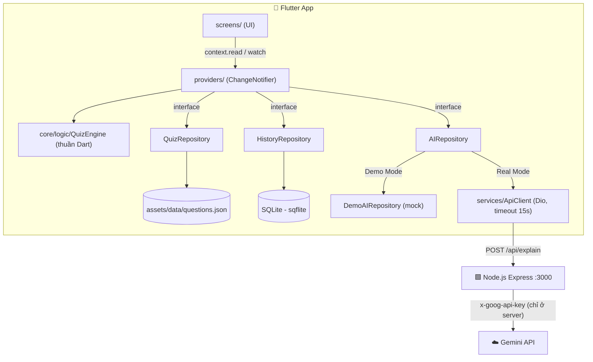
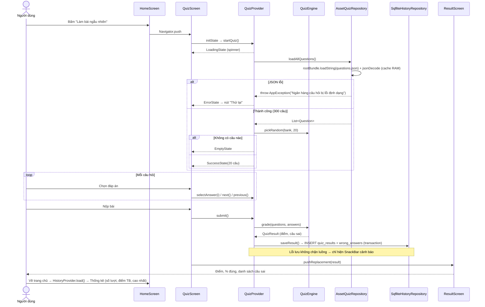
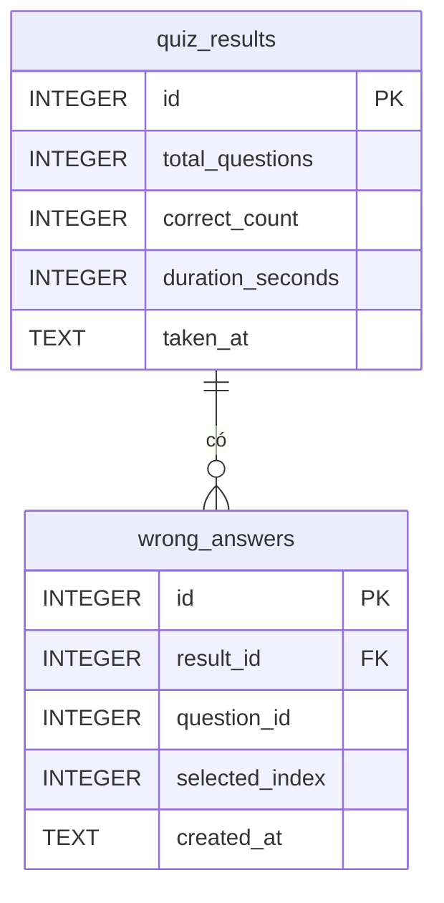
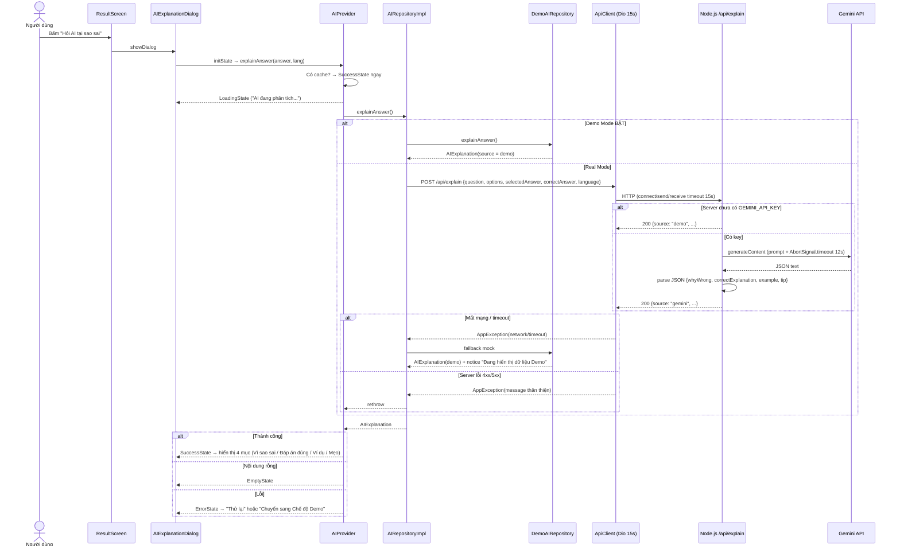

# Kiến trúc & Luồng dữ liệu – Đề tài #32: Ôn tập trắc nghiệm song ngữ (+ Mở rộng AI)

> [!IMPORTANT]
> **QUY TẮC ĐỌC & TRIỂN KHAI KIẾN TRÚC:**
> - Tài liệu này là chuẩn tham chiếu chung cho cả 4 thành viên. Khi đọc sơ đồ luồng hoặc viết code nối giữa các tầng (`Screen` $\leftrightarrow$ `Provider` $\leftrightarrow$ `Repository` $\leftrightarrow$ `Service / Server`), **nếu có bất kỳ điểm nào chưa rõ hoặc thiếu ngữ cảnh thì PHẢI HỎI LẠI NGAY, TUYỆT ĐỐI KHÔNG ĐOÁN MÒ**.
> - Không tự ý gọi tắt qua các tầng (ví dụ: không gọi `ApiClient` hay `LocalDatabase` trực tiếp từ `Screen`) và không tự ý thay đổi kiểu trả về của `ViewState<T>` khi chưa hỏi ý kiến cả nhóm.

## 1. Tổng quan kiến trúc

Ứng dụng tách 3 tầng rõ ràng (Clean Architecture rút gọn + Provider):

| Tầng | Thư mục | Trách nhiệm | Được phép phụ thuộc |
|---|---|---|---|
| **UI** | `lib/screens/` | Vẽ giao diện, bắt sự kiện, render theo `ViewState` | providers, models |
| **State / Logic** | `lib/providers/`, `lib/core/logic/` | Quản lý trạng thái, nghiệp vụ (random, chấm điểm) | repositories (interface), models |
| **Data** | `lib/repositories/`, `lib/services/` | Đọc JSON, SQLite, gọi HTTP | models, core |
| **Backend** | `server/` | Giữ `GEMINI_API_KEY`, gọi Gemini | – |



### Nguyên tắc bắt buộc (map với Rubric)

| Rubric | Cách đáp ứng |
|---|---|
| Tách UI / logic / dữ liệu | UI chỉ gọi Provider; Provider chỉ biết **interface** repository. |
| Không gọi mạng trong `build()` | Mọi lần tải dữ liệu được kích hoạt trong `initState()` qua `addPostFrameCallback`. |
| Thay thế được bằng mock | `AppDependencies` (Composition Root) + constructor injection. Test dùng `FakeQuizRepository`, `FakeHistoryRepository`, `DemoAIRepository`, Dio adapter giả. |
| Timeout + try-catch + lỗi thân thiện | `ApiClient` timeout 15s; mọi lỗi → `AppException(message tiếng Việt)`. Server gọi Gemini có `AbortSignal.timeout(12s)`. |
| Loading / Error / Empty | `sealed class ViewState<T>` → `switch` trong UI bắt buộc xử lý đủ nhánh. |
| API key ở server | Key chỉ nằm trong `server/.env` (bị `.gitignore`). App Flutter không có key. |
| Chế độ Demo | (1) Công tắc Demo trong app; (2) mất mạng → tự fallback mock; (3) server chưa có key → server trả mock. |
| Hồ sơ AI | `docs/ai/` lưu lịch sử prompt. |

---

## 2. Luồng Offline – Làm bài trắc nghiệm

**Nạp 300 câu từ JSON → Random câu hỏi → Người dùng chọn → Chấm điểm → Thống kê**



**Chi tiết từng bước**

1. **Nạp dữ liệu**: `AssetQuizRepository` đọc `assets/data/questions.json` (offline 100%), parse thành `List<Question>`, cache lại để lần sau không đọc file nữa.
2. **Random**: `QuizEngine.pickRandom()` xáo trộn bản sao và lấy `AppConfig.questionsPerQuiz` (20) câu không trùng. Chế độ "Ôn lại câu sai" lọc theo `question_id` trong bảng `wrong_answers`.
3. **Chọn đáp án**: `QuizProvider` lưu `Map<indexCâu, indexĐápÁn>`; UI tự rebuild nhờ `notifyListeners()`.
4. **Chấm điểm**: `QuizEngine.grade()` (hàm thuần → unit test được) trả `QuizResult` gồm số câu đúng, điểm thang 10, danh sách `UserAnswer` sai.
5. **Thống kê**: kết quả lưu SQLite; `HistoryProvider` đọc lại để tính số lượt, điểm trung bình, điểm cao nhất.

**Lược đồ SQLite** (`lib/services/local_database.dart`)



---

## 3. Luồng AI – Giải thích câu sai

**UI gọi `explainAnswer()` → Provider → `AIRepository` → (Demo: mock | Real: Node.js, timeout 15s) → Gemini → App → Dialog**



**Prompt gửi Gemini** (`server/src/services/prompt.builder.js`):

> Giải thích chi tiết tại sao đáp án này sai và đưa ra ví dụ.
> (kèm câu hỏi, các lựa chọn, đáp án người học chọn, đáp án đúng; yêu cầu trả về JSON `{whyWrong, correctExplanation, example, tip}`)

**Hợp đồng API**

```http
POST /api/explain
Content-Type: application/json

{
  "question": "Choose the correct tense: \"She ___ here since 2010.\"",
  "options": ["lives", "lived", "has lived", "is living"],
  "selectedAnswer": "lived",
  "correctAnswer": "has lived",
  "language": "en"
}
```

```json
200 OK
{
  "source": "gemini",
  "whyWrong": "...",
  "correctExplanation": "...",
  "example": "...",
  "tip": "..."
}
```

Lỗi: `{ "error": { "message": "<thông báo thân thiện>" } }` với mã 400 / 429 / 502 / 504.

---

## 4. Ma trận Base URL (tự nhận diện thiết bị)

Xử lý tại `lib/services/base_url_resolver.dart`:

| Môi trường | Base URL | Lưu trữ lịch sử | Cách chạy |
|---|---|---|---|
| Android Emulator | `http://10.0.2.2:3000` | SQLite (`sqflite`) | `flutter emulators --launch pixel_avd` rồi `flutter run -d emulator-5554` |
| Web (Chrome / Edge) | `http://localhost:3000` | RAM (`InMemoryHistoryRepository`) | `flutter run -d chrome` |
| iOS Simulator | `http://localhost:3000` | SQLite (`sqflite`) | `flutter run` |
| Thiết bị thật | IP LAN của máy tính | SQLite (`sqflite`) | `flutter run --dart-define=API_BASE_URL=http://192.168.x.x:3000` |
| Ghi đè thủ công | giá trị `API_BASE_URL` | theo nền tảng | luôn được ưu tiên nếu có |

> Thiết bị thật nhưng quên `API_BASE_URL` → request lỗi kết nối → `AIRepositoryImpl` tự fallback Demo, app không bị crash.

